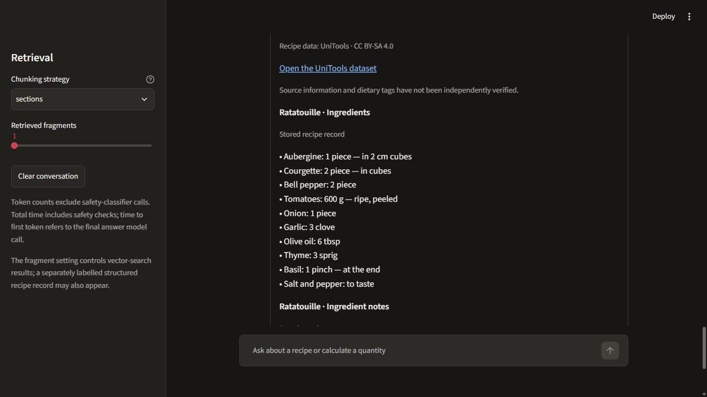

# Final test: conversational MVP v10

Test date: 27 November 2026. App: `app_ollama_conversation_v10.py`; local answer and evaluation model: Ollama `qwen2.5:7b`. The results below are snapshots of actual runs, not claims of universal correctness. Previous versions and result files were retained.

## Change discovered during testing

In v9 the **Retrieved fragments** slider was ignored on the deterministic source-answer path: choosing one still retrieved five vector fragments. V10 passes the slider setting through `conversation_v8.py` to `structured_evidence_v2.py`. The latter appends an exact stored recipe record separately: selecting one means one vector result **plus** that record, not one total source. `test_final_settings_v1.py` records the original failure and `test_final_settings_v2.py` verifies both section and recipe chunking at settings 1 and 5, as well as chat reset. Smaller values can still miss useful search results.



## Coverage and results

| Test | Result | Scope |
|---|---|---|
| Settings | 4/4 passed | 1 and 5 vector results, both chunking strategies; chat reset |
| Realistic conversation | 21/21 targeted checks | 7 conversations, 19 turns; checks do not prove every answer is correct |
| Diagnostic | 20/20 expected routes; 6/6 exact tool results | Includes 13 retrieval cases; references derived from project data |
| Evidence | 36/36 exact structured ingredient records | All records; three live UI examples and separate source-panel checks |
| Safety | 11/11 selected checks | Selected hazards, allergy, injection and normal requests; not a safety certification |
| Scaling | 36/36 | MCP calculation for doubling each recipe, not arbitrary factors or every full conversation |
| Extra cases | 5/6 automated checks | The Dutch check was too weak and missed an inaccurate translation, described below |

The screenshot captures a genuine browser run; the exact count is also checked by the automated test.

## Ragas, final version

13 retrieval cases scored on all three metrics: context precision **0.838**, context recall **0.885**, faithfulness **0.877** (means). The local Qwen model was both the answer model and the judge, and the reference answers were derived from project data. These results are not independent human verification. They exclude the conversion, scaling and greeting diagnostic cases and do not assess multi-turn conversations. Individual case results are in the JSON below. For Q12, the separately sourced 71°C food-safety adaptation can be penalized as unsupported when Ragas sees only recipe context.

## Failures and limitations to address

* On `Scale Guacamole to 0 servings`, the safety layer returned a generic uncertainty refusal instead of explaining that the serving count must be positive. No scaling tool ran. `Convert 250 g to cups` also received a generic uncertainty refusal; it did not invent a conversion, but failed to explain that ingredient/density is needed. The logs do not distinguish classifier uncertainty from a classifier/schema/inference failure, so do not assume which occurred.
* The Dutch Guacamole answer said the tomato was “gezaaid en gegratineerd”; the stored note is “seeded and diced”. It also gave an unclear translation for coriander sprigs. The extra test only checked that avocado and the recipe focus appeared, so it reported a pass despite this error. The deterministic ingredient matcher recognizes `ingredienten` but not the accented `ingrediënten`; this appears to have sent the wording through a generative path. This should be verified and fixed with stronger multilingual assertions before submission.
* Prior source-data and attribution concerns still merit review. A successful local run uses the existing environment and cached model; a fresh installation was not validated here.

The failure evidence is the saved response text and raw data, rather than a screenshot of the failures. No screenshots of these failure cases were captured in this run.

## Reproduction and raw evidence

Run from the project folder in the existing environment, with Ollama running and `qwen2.5:7b` available. The runs can take time and model output varies. These commands run local tests; the Ragas command is the costly evaluation.

```powershell
.\.venv\Scripts\python.exe v4\test_final_settings_v2.py
.\.venv\Scripts\python.exe v4\test_evidence_final_v1.py
.\.venv\Scripts\python.exe v4\test_source_display_final_v1.py
.\.venv\Scripts\python.exe v4\test_safety_final_v1.py
.\.venv\Scripts\python.exe v4\test_all_scaling_v1.py
.\.venv\Scripts\python.exe v4\realistic_conversations_v4.py --app app_ollama_conversation_v10.py
.\.venv\Scripts\python.exe v4\diagnostic_final_v1.py
.\.venv\Scripts\python.exe v4\final_extra_cases_v1.py
```

Use the diagnostic file produced by a new run as input to `ragas_ollama_diagnostic_v2.py`; the recorded Ragas run used `results/diagnostic_final_v1_20261127_084527_655900.json` with `--limit 13`. See the report for exact result filenames. A new run may differ.

## Recorded result files

- Original settings failure: `results/final_settings_v1_20261127_084211_515900.json`
- V10 settings verification: `results/final_settings_v2_20261127_084250_806500.json`
- Ingredient evidence: `results/evidence_final_v1_20261127_084326_024600.json`
- Source display and raw data: `results/source_display_final_v1_20261127_084345_198400.json`
- Safety: `results/safety_final_v1_20261127_084413_691700.json`
- Scaling: `results/scaling_all_recipes_v1_20261127_084431_025900.json`
- Conversations: `results/realistic_conversations_v4_20261127_084440_526600.json` and `results/realistic_assessment_v1_20261127_084512_896800.json`
- Diagnostic: `results/diagnostic_final_v1_20261127_084527_655900.json`
- Ragas raw: `results/ragas_ollama_diagnostic_v2_20261127_084609_619000.json`; summary: `results/ragas_conversation_summary_v1_20261127_084904_120400.json`
- Additional edge cases: `results/final_extra_cases_v1_20261127_085022_071200.json`
